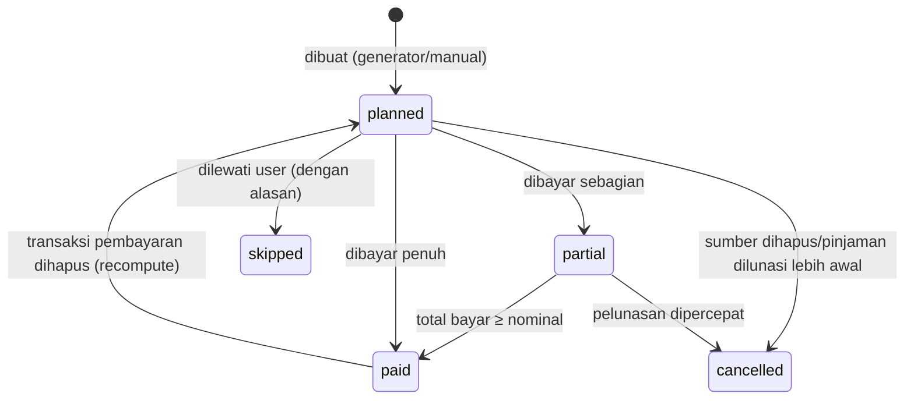
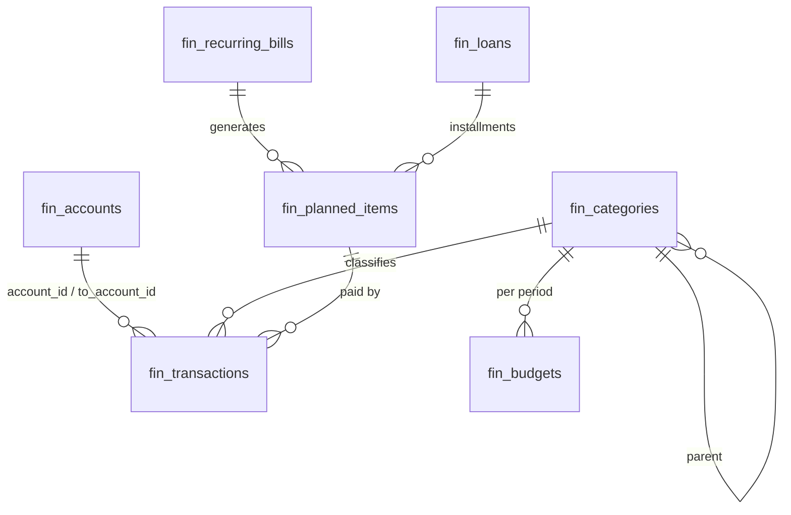

# 💰 Modul Finance — Keuangan, Anggaran & Pinjaman
**Dokumen:** 01-MODULE-FINANCE.md
**Versi:** 0.2
**Fase:** Phase 1
**Prefix tabel:** `fin_` · **Prefix task:** `FIN-` · **Namespace:** `App\Modules\Finance`
**Prasyarat:** Phase 0 (Core) selesai. Baca `00-MASTERPLAN.md` terlebih dahulu.

---

## 1. Tujuan

Membantu suami & istri:
1. Mencatat uang masuk/keluar dengan cepat dan **transparan** (keduanya melihat semua).
2. Menyusun **Rencana Bulanan**: pemasukan rutin, kewajiban tetap (tagihan & cicilan), dan anggaran pengeluaran variabel.
3. Mengelola **pinjaman** (hutang yang kita bayar, dan piutang yang orang lain bayar ke kita) beserta jadwal cicilannya, yang **otomatis masuk ke rencana bulanan**.
4. Melihat apakah keuangan bulan ini "aman": rencana vs realisasi.

## 2. Scope

| Masuk MVP | Ditunda (v1.1+) | Tidak dibangun |
|---|---|---|
| Akun/dompet, kategori, transaksi (masuk/keluar/transfer), lampiran struk | Goals/tabungan tujuan (FIN-V11-1) | Integrasi bank |
| Anggaran per kategori per periode | Split transaksi (1 struk → banyak kategori) | Multi mata uang |
| Lima alokasi dana dengan persentase custom, rincian penggunaan, dan transfer tabungan teralokasi | | Pelacakan portofolio/nilai pasar investasi |
| Tagihan & pemasukan rutin | Import CSV mutasi bank | Investasi |
| **Rencana Bulanan** (planned items) | Laporan PDF | Invoice belum dibayar (tidak membuat PlannedItem dari scan) |
| Pinjaman (hutang & piutang) + jadwal cicilan otomatis | Kalkulator bunga anuitas/efektif | |
| Laporan dasar + ekspor CSV | Arisan tracker | |
| Scan struk yang sudah dibayar: OCR lokal menyarankan merchant, tanggal, dan total untuk draft transaksi yang wajib ditinjau user | | OCR cloud / pengiriman struk ke layanan eksternal |

## 3. Glosarium (WAJIB konsisten di UI & kode)

| Istilah UI (ID) | Istilah kode | Definisi |
|---|---|---|
| Akun | `Account` | Tempat uang berada: dompet tunai, rekening bank, e-wallet, kartu kredit, tabungan |
| Transaksi | `Transaction` | Perpindahan uang yang **sudah terjadi** |
| Pemasukan / Pengeluaran / Transfer | `income` / `expense` / `transfer` | Jenis transaksi |
| Kategori | `Category` | Klasifikasi transaksi, maks 2 level (induk → sub) |
| Periode | `Period` | "Bulan keuangan" sesuai `PeriodResolver` (Masterplan §7.2) |
| Anggaran | `Budget` | Batas pengeluaran **variabel** per kategori per periode (makan, transport, hiburan) |
| Alokasi | `Allocation` | Kelompok tujuan dana lintas kategori: Kebutuhan Hidup, Tersier, Cicilan / Utang, Tabungan & Investasi, Donasi / Sosial / Zakat. Berbeda dari anggaran kategori |
| Tagihan Rutin | `RecurringBill` (direction=expense) | Kewajiban berulang: listrik, internet, SPP, BPJS, asuransi |
| Pemasukan Rutin | `RecurringBill` (direction=income) | Gaji, tunjangan, sewa kos |
| Pinjaman | `Loan` | Kontrak pinjam-meminjam dengan jadwal pembayaran |
| Hutang | `Loan` direction=`payable` | **Kita meminjam**, kita yang membayar cicilan (KPR, kredit motor, pinjaman ke saudara) |
| Piutang | `Loan` direction=`receivable` | **Orang lain meminjam dari kita**, mereka yang membayar ke kita |
| Cicilan / Angsuran | `PlannedItem` (source=loan) | Satu jadwal pembayaran pinjaman |
| Rencana / Item Rencana | `PlannedItem` | Uang masuk/keluar yang **direncanakan** pada tanggal tertentu dan belum tentu terjadi |
| Realisasi | – | Transaksi aktual |

> ⚠️ Catatan istilah: kebutuhan reviewer "input yang dipinjam, angsuran, jatuh tempo, total bayar, otomatis jadi pengeluaran bulanan" = **Hutang** (`payable`). Piutang tetap didukung dengan mekanisme yang sama tetapi arah sebaliknya (menjadi rencana **pemasukan**).

## 4. Konsep Inti: Rencana Bulanan

```
                    RENCANA BULANAN (Periode Nov 2026)
┌────────────────────────────────────────────────────────────────────┐
│ A. Rencana Pemasukan      ← PlannedItem income (gaji, piutang)     │
│ B. Kewajiban Tetap        ← PlannedItem expense                    │
│      • Tagihan rutin  (dari RecurringBill)                         │
│      • Cicilan hutang (dari Loan)                                  │
│      • Rencana manual (sekali, mis. "Bayar pajak motor")           │
│      • Perawatan aset (dari modul Asset, opsional)                 │
│ C. Anggaran Variabel      ← Budget per kategori                    │
├────────────────────────────────────────────────────────────────────┤
│ Sisa Rencana = A − (B + C)   → hijau jika ≥ 0, merah jika < 0      │
└────────────────────────────────────────────────────────────────────┘
```

**Aturan anti-dobel hitung (BR-FIN-030):** Pengeluaran yang terkait PlannedItem (punya `planned_item_id`) **tidak** dihitung sebagai pemakaian Anggaran (C). Anggaran hanya mengukur pengeluaran variabel. Dengan begitu kategori "Listrik" boleh punya tagihan rutin tanpa terhitung dua kali.

**Siklus hidup PlannedItem:**

Status `overdue` **bukan** status tersimpan; dihitung: `status in (planned, partial) AND due_date < today`.

---

## 5. User Stories & Acceptance Criteria

### US-FIN-01 Catat pengeluaran cepat
*Sebagai istri, saya ingin mencatat pengeluaran dalam ≤ 3 tap agar tidak malas mencatat.*
- **AC1** Dari FAB → "Pengeluaran" → bottom sheet berisi: keypad nominal (autofocus), grid kategori (8 kategori paling sering 30 hari terakhir + "Lainnya"), akun (default = akun terakhir dipakai user tsb), tanggal (default hari ini), catatan (opsional), lampiran foto (opsional).
- **AC2** Tap kategori **langsung menyimpan** jika nominal > 0 (mode cepat). Toggle "Detail" untuk mengisi field lain sebelum simpan.
- **AC3** Setelah simpan: toast "Pengeluaran Rp 45.000 – Makan tersimpan [Batalkan]" selama 5 detik; Batalkan = soft delete.
- **AC4** Nominal mendukung input "45rb", "1,2jt" (Money::parse).
- **AC5** Aksi "Scan struk" menerima foto dari kamera/galeri dan menjalankan OCR secara lokal, tanpa mengirim dokumen ke layanan eksternal. OCR hanya menyarankan merchant (`payee`), tanggal (`occurred_on`), dan total (`amount`); user wajib meninjau/mengubah draft dan menekan simpan. Jalur scan selalu memakai langkah review (tidak memakai auto-save AC2). Tidak ada ekstraksi item baris atau penyimpanan otomatis. Jika OCR gagal/tidak yakin, user tetap dapat mengisi form manual. File struk yang dipindai dilampirkan ke transaksi setelah disimpan.
- **AC6** Untuk transaksi income/expense, sistem boleh menyarankan kategori berdasarkan riwayat transaksi household dan payee yang cocok. Saran tidak pernah memilih/menyimpan kategori tanpa konfirmasi user; tidak memakai layanan eksternal.
- **AC7** Form menampilkan alokasi, kategori, dan rincian yang spesifik (mis. Kebutuhan Hidup → Transportasi → Bensin; Tersier → Perawatan Diri → Skincare). Memilih alokasi saja tidak menyimpan transaksi. Mode cepat memakai rincian yang sudah lengkap, bukan label alokasi umum; mode detail wajib memilih rincian jika kategori memiliki subkategori.
- **AC8** Pilihan Tabungan & Investasi membuka pencatatan tujuan dana: Dana Darurat/Tabungan Masa Depan/Investasi. Setoran antar akun milik sendiri memakai transfer + akun tujuan yang berbeda, bukan expense. Jika dana benar-benar keluar ke pihak luar, user memilih expense secara eksplisit. UI menjelaskan dampak pada saldo dan laporan sebelum simpan.

### US-FIN-02 Transfer antar akun
- **AC1** Pilih akun asal & tujuan (tidak boleh sama), nominal, tanggal. Biaya admin opsional → dicatat sebagai transaksi expense terpisah kategori "Biaya Admin Bank", ditautkan (`related_transaction_id`).
- **AC2** Transfer ke tabungan/dana darurat/investasi milik sendiri boleh diberi alokasi Tabungan & Investasi serta rincian tujuan; dihitung sekali sebagai dana ditempatkan, bukan pengeluaran konsumsi. Transfer biasa tidak masuk penggunaan alokasi. Pengembalian dana ke rekening belanja dapat ditandai sebagai pembalikan setoran dengan referensi transaksi asal dan mengurangi penempatan neto, maksimal sisa setoran asal; transfer di antara akun tabungan tidak dihitung sebagai setoran baru.
- **AC2** Bayar tagihan kartu kredit = transfer dari bank ke akun kartu kredit.

### US-FIN-03 Kelola akun
- **AC1** Buat akun: nama, tipe, saldo awal, tanggal saldo awal, warna/ikon, "hitung dalam total saldo".
- **AC2** Kartu kredit: saldo awal diisi sebagai tagihan berjalan (disimpan negatif), field `credit_limit` opsional.
- **AC3** Akun yang punya transaksi **tidak bisa dihapus**, hanya diarsipkan. Akun arsip tidak muncul di pilihan input, tetapi transaksinya tetap di laporan.
- **AC4** "Sesuaikan saldo": user mengisi saldo nyata → sistem membuat transaksi income/expense kategori sistem "Penyesuaian Saldo" sebesar selisih.
- **AC5** Saat rekonsiliasi akhir periode, user dapat memasukkan saldo aktual tiap akun per tanggal akhir periode dan membandingkannya dengan saldo terhitung. Selisih ditampilkan untuk ditinjau; transaksi penyesuaian kategori sistem hanya dibuat setelah user mengonfirmasi, bertanggal pada tanggal rekonsiliasi. Rekonsiliasi historis menggunakan saldo akun pada tanggal tersebut.

### US-FIN-04 Anggaran
- **AC1** Halaman Anggaran per periode menampilkan setiap kategori induk expense: nominal anggaran, terpakai, sisa, progress bar.
- **AC2** "Salin dari periode sebelumnya" mengisi semua anggaran periode aktif (yang belum ada).
- **AC3** Notifikasi saat pemakaian menembus 80% dan 100% (sekali per ambang per periode per kategori).
- **AC4** Pemakaian = Σ expense kategori tsb + sub-kategorinya dalam periode, **tanpa** transaksi yang memiliki `planned_item_id` (BR-FIN-030).
- **AC5** User dapat menaikkan anggaran kategori terpilih secara manual selama periode berjalan, misalnya setelah mencatat pemasukan tambahan. Pemasukan tidak mengubah anggaran secara otomatis.
- **AC6** Sisa anggaran positif pada akhir periode ditampilkan sebagai belum terpakai, bukan transaksi yang hilang. Rekonsiliasi saldo akun adalah alur terpisah dan tidak mengubah anggaran secara otomatis.

### US-FIN-04A Alokasi dana per periode
- **AC1** Tampilkan lima alokasi: **Kebutuhan Hidup** (makan, transportasi, operasional rumah), **Tersier** (hiburan, rekreasi, dining out, hobi, skincare), **Cicilan / Utang** (KPR, kendaraan, utang produktif), **Tabungan & Investasi** (dana darurat, masa depan), dan **Donasi / Sosial / Zakat** (zakat, infak, sedekah, dana sosial).
- **AC2** User mengonfirmasi dasar penghasilan periode dalam rupiah, lalu mengatur persentase tiap alokasi 0–100% (maksimal 2 desimal); jumlah maksimal 100%. Sisa persentase dan nominal ditampilkan sebagai **Belum dialokasikan**. Tidak ada rasio wajib/default normatif; contoh demo hanya ilustrasi.
- **AC3** Target nominal tiap alokasi = floor(dasar penghasilan × persentase / 100). Sisa pembulatan tetap masuk Belum dialokasikan. Dasar penghasilan tidak memasukkan saldo awal, transfer, pencairan pinjaman, atau penyesuaian saldo. Pemasukan baru tidak mengubah target otomatis; user boleh mengubah dasar/persentase secara eksplisit dengan preview dan audit log.
- **AC4** Tiap alokasi menampilkan persentase, target, **Digunakan/Ditempatkan**, sisa atau kelebihan, dan rincian kategori/transaksi. Penggunaan = expense aktual (termasuk pembayaran PlannedItem) + penempatan tabungan neto bertanda alokasi. Rencana belum dibayar dan anggaran kategori bukan realisasi; jangan menjumlahkannya lagi. Target Tabungan adalah target setoran periode, bukan saldo dana darurat sepanjang masa.
- **AC5** Peringatan cicilan memakai total rencana pembayaran utang periode / dasar penghasilan (termasuk yang sudah dibayar, tanpa menggandakan transaksi pembayarannya); >30% menampilkan peringatan, bukan pemblokiran. Tampilkan juga persentase realisasi pembayaran. Jika dasar nol/belum diisi, tampilkan "Isi dasar penghasilan untuk menghitung rasio", bukan 0% atau pembagian nol.
- **AC6** Alokasi bukan tambahan pos pengeluaran pada Sisa Rencana; jangan menjumlahkan target alokasi + anggaran + kewajiban. Anggaran variabel tetap mengikuti BR-FIN-030. Perubahan periode mempertahankan konfigurasi historis; penyalinan target/persentase ke periode baru memerlukan konfirmasi.

### US-FIN-05 Tagihan & pemasukan rutin
- **AC1** Buat: nama, arah (masuk/keluar), kategori, akun default, nominal, "nominal berubah-ubah" (mis. listrik), pola ulang (preset Masterplan §7.4), tanggal mulai, tanggal berakhir (opsional), pengingat H-n (default 3).
- **AC2** Sistem membuat PlannedItem untuk semua kejadian dalam horizon **3 periode ke depan** (config `finance.plan_horizon_periods`).
- **AC3** Ubah nominal/pola → PlannedItem **masa depan yang berstatus planned** diperbarui/diregenerasi; yang sudah paid/partial/skipped tidak disentuh.
- **AC4** Nonaktifkan → PlannedItem planned di masa depan menjadi `cancelled`.

### US-FIN-06 Pinjaman (Hutang) — *kebutuhan utama reviewer*
*Sebagai suami, saya ingin memasukkan pinjaman beserta angsurannya sehingga setiap bulan cicilan otomatis muncul di rencana pengeluaran.*
- **AC1** Form pinjaman:
  | Field | Wajib | Keterangan |
  |---|:-:|---|
  | Arah | ✅ | Hutang (kita bayar) / Piutang (kita terima) |
  | Nama pinjaman | ✅ | "KPR BTN", "Kredit Motor", "Pinjam ke Budi" |
  | Pihak | ✅ | Bank/leasing/nama orang |
  | Pokok pinjaman (jumlah dipinjam) | ✅ | |
  | Jumlah cicilan (kali) | ✅ | 1 = bayar sekali |
  | Frekuensi | ✅ | Bulanan (default) / Mingguan / Sekali |
  | Nominal per cicilan | ✅ | |
  | Total yang harus dibayar | otomatis | default = nominal × jumlah; boleh di-override (jika cicilan terakhir berbeda) |
  | Jatuh tempo cicilan pertama | ✅ | Tanggal ini menentukan tanggal jatuh tempo berikutnya (tanggal yang sama tiap bulan; jika tidak ada, misal 31 → akhir bulan) |
  | Cicilan sudah dibayar sebelumnya | opsional | Untuk pinjaman lama: N cicilan pertama ditandai `paid` tanpa membuat transaksi (flag `paid_before_tracking=true`) |
  | Akun pembayaran default | ✅ | |
  | Kategori | ✅ | Default sistem: "Cicilan & Pinjaman" (expense) / "Penerimaan Piutang" (income) |
  | Catat pencairan dana sebagai transaksi | opsional | Hutang: pemasukan ke akun; Piutang: pengeluaran dari akun. Kategori sistem "Pencairan Pinjaman"/"Pemberian Pinjaman" |
  | Info bunga | opsional | Catatan teks bebas; MVP tidak mengalokasikan bunga per cicilan |
  | Pengingat H-n | ✅ | default 3 |
  | Catatan & lampiran (akad/kontrak) | opsional | |
- **AC2** Saat disimpan, sistem membuat **seluruh** jadwal cicilan sebagai PlannedItem (`source_type=loan`, `sequence=1..n`). Jika total ≠ nominal × n, selisih diserap **cicilan terakhir** (BR-FIN-041).
- **AC3** Setiap cicilan otomatis tampil di Rencana Bulanan periode jatuh temponya, di Kalender, dan mendapat pengingat H-n & H0 pukul 08:00.
- **AC4** Detail pinjaman menampilkan: pokok, total pembayaran yang direncanakan, **selisih total** (`max(total_payable − principal, 0)`), total dibayar, sisa yang harus dibayar, progres (x/n cicilan), cicilan berikutnya, perkiraan tanggal lunas, tabel jadwal (status per cicilan). Selisih ini bukan bunga/biaya yang dihitung secara akuntansi dan tidak dialokasikan per cicilan.
- **AC5** Tombol "Bayar" pada cicilan → membuat transaksi (nominal default = sisa cicilan, bisa diubah; akun default dari pinjaman). Bayar lebih kecil → `partial`.
- **AC6** **Pelunasan dipercepat**: input nominal pelunasan & tanggal → satu transaksi pembayaran, semua cicilan belum lunas → `cancelled` (alasan "Dilunasi lebih awal"), pinjaman → `paid_off`.
- **AC7** Ubah pinjaman: jika belum ada cicilan dibayar → regenerasi total. Jika sudah ada → hanya cicilan berstatus `planned` yang diregenerasi; jumlah cicilan baru tidak boleh < jumlah cicilan yang sudah paid/partial.
- **AC8** Saat semua cicilan `paid` → status pinjaman otomatis `paid_off` + notifikasi "🎉 Pinjaman {nama} lunas!".

### US-FIN-07 Rencana Bulanan
- **AC1** Halaman `/finance/plan?period=YYYY-MM-DD` dengan `x-period-switcher` yang menampilkan label bulan dan rentang tanggal periode aktual.
- **AC2** Kartu ringkasan: Rencana Masuk, Rencana Keluar (Kewajiban + Anggaran), **Sisa Rencana**, Realisasi Masuk, Realisasi Keluar, Kewajiban belum dibayar.
- **AC3** Daftar Kewajiban Tetap dikelompokkan: Terlambat → Belum dibayar (urut jatuh tempo) → Sebagian → Lunas → Dilewati. Tiap baris: nama, sumber (ikon tagihan/pinjaman/aset/manual), jatuh tempo, nominal, status badge, aksi [Bayar] [Lewati].
- **AC4** Daftar Rencana Pemasukan dengan aksi [Terima] (membuat transaksi income).
- **AC5** Bagian Anggaran Variabel (ringkas, link ke halaman Anggaran), serta ringkasan lima alokasi/persentase/target/realisasi/sisa sesuai US-FIN-04A. Keduanya tampilan analisis terpisah, bukan dua pengeluaran yang dijumlahkan.
- **AC6** Tambah rencana manual sekali (nama, arah, kategori, nominal, tanggal, akun).
- **AC7** Periode masa depan bisa dibuka (melihat beban cicilan bulan-bulan berikutnya) sampai horizon tagihan rutin; cicilan pinjaman tampil sampai lunas berapa pun jauhnya.

### US-FIN-08 Daftar & pencarian transaksi
- **AC1** Daftar dikelompokkan per tanggal dengan subtotal harian; infinite scroll 30 item.
- **AC2** Filter chip: periode, jenis, akun, kategori, pencatat (suami/istri), "punya lampiran". Pencarian teks pada catatan & penerima.
- **AC3** Setiap baris menampilkan avatar pencatat (transparansi).

### US-FIN-09 Laporan
- **AC1** Arus kas periode (masuk vs keluar per minggu, bar chart).
- **AC2** Pengeluaran per kategori (donut + tabel, drill-down ke sub-kategori → daftar transaksi).
- **AC3** Tren 12 periode (masuk, keluar, selisih).
- **AC4** Ringkasan pinjaman: total sisa hutang, total sisa piutang, beban cicilan per periode 12 bulan ke depan (bar).
- **AC5** Ekspor CSV transaksi sesuai filter aktif.
- **AC6** Laporan akhir periode menampilkan sisa anggaran sebagai belum terpakai dan menyediakan ringkasan rekonsiliasi saldo aktual vs terhitung per akun. Selisih hanya menjadi transaksi penyesuaian setelah dikonfirmasi user.

---

## 6. Data Model

Semua tabel: `id` ULID, `household_id` (FK, index), `created_by` (FK users nullable), `timestamps`, `softDeletes` kecuali disebut lain. Uang = `bigInteger`.

### 6.1 `fin_accounts`
| Kolom | Tipe | Aturan |
|---|---|---|
| name | string(60) | unik per household (case-insensitive, di validasi aplikasi) |
| type | string `AccountType` | `cash`, `bank`, `ewallet`, `credit_card`, `savings` |
| opening_balance | bigint default 0 | kartu kredit: negatif = tagihan |
| opening_date | date | transaksi sebelum tanggal ini ditolak |
| credit_limit | bigint nullable | hanya credit_card |
| color | string(7) | |
| icon | string(40) | nama heroicon |
| include_in_total | bool default true | |
| sort_order | int default 0 | |
| archived_at | datetime nullable | |

### 6.2 `fin_categories`
| Kolom | Tipe | Aturan |
|---|---|---|
| parent_id | FK self nullable | maks kedalaman 2 |
| name | string(50) | |
| type | string `CategoryType` | `income`, `expense` |
| icon, color | string | |
| system_key | string(40) nullable unique per household | kategori sistem: `balance_adjustment`, `loan_installment`, `loan_receipt`, `loan_disbursement_in`, `loan_disbursement_out`, `bank_fee`, `asset_maintenance`, `shopping`. Tidak bisa dihapus/diubah tipenya |
| default_allocation | string nullable | salah satu dari lima key alokasi §6.4A; default saran kategori/subkategori expense, dapat diubah saat input tanpa memindahkan histori |
| sort_order | int | |
| archived_at | datetime nullable | |

### 6.3 `fin_transactions`
| Kolom | Tipe | Aturan |
|---|---|---|
| type | string `TransactionType` | `income`, `expense`, `transfer` |
| account_id | FK fin_accounts | akun sumber (untuk income = akun penerima) |
| to_account_id | FK nullable | wajib jika transfer, ≠ account_id |
| category_id | FK nullable | wajib jika income/expense; null jika transfer; tipe kategori harus sesuai |
| amount | bigint | **> 0** selalu; arah ditentukan `type` |
| occurred_on | date | index |
| note | string(255) nullable | |
| payee | string(100) nullable | penerima/pemberi |
| planned_item_id | FK nullable fin_planned_items | index |
| related_transaction_id | FK self nullable | biaya admin transfer |
| source_type / source_id | nullable morph | asal dari modul lain (`ast_service_record`, `org_shopping_list`) |
| updated_by | FK users nullable | |
| allocation | string nullable | snapshot key alokasi saat transaksi; expense normal wajib, income/transfer biasa null. Penyesuaian saldo tidak masuk penggunaan alokasi |
| allocation_detail | string(100) nullable | tujuan untuk transfer Tabungan & Investasi (Dana Darurat/Tabungan Masa Depan/Investasi); expense memakai kategori/subkategori |
| allocation_reversal_of_id | FK self nullable | transfer pembalikan setoran tabungan; wajib sumber/tujuan terbalik dan household sama; jangan melebihi setoran neto asal |

`category_id` tetap null pada transfer: rincian tujuan memakai `allocation_detail`, bukan kategori expense palsu. Gateway lintas modul memakai default alokasi kategori yang telah ditinjau; pemanggil dapat memberi override alokasi valid. Perubahan default kategori tidak menghitung ulang alokasi transaksi historis.

### 6.4 `fin_budgets`
| Kolom | Tipe | Aturan |
|---|---|---|
| category_id | FK | hanya kategori **induk** type expense |
| period | char(10) `YYYY-MM-DD` | tanggal mulai aktual periode dari `PeriodResolver`; jangan gunakan label bulan sebagai key |
| amount | bigint ≥ 0 | |
| alert_80_sent_at / alert_100_sent_at | datetime nullable | |
| unique | (household_id, category_id, period) | |

### 6.4A `fin_allocation_plans`
Satu konfigurasi per household/periode: `period` char(10), `income_base` bigint ≥ 0, dan lima kolom persen dalam basis point integer (`living_bps`, `tertiary_bps`, `debt_bps`, `savings_bps`, `social_bps`; masing-masing 0..10000, total ≤10000). Unique (`household_id`,`period`); kolom domain mengikuti Masterplan. Tidak memakai float untuk hitungan uang. Key alokasi: `living`, `tertiary`, `debt`, `savings`, `social`; label UI sesuai US-FIN-04A. Target/penggunaan/sisa dihitung, bukan saldo yang diedit manual.

### 6.5 `fin_recurring_bills`
| Kolom | Tipe | Aturan |
|---|---|---|
| name | string(80) | |
| direction | string `Direction` | `income`, `expense` |
| category_id | FK | tipe sesuai direction |
| account_id | FK | akun default |
| amount | bigint > 0 | estimasi |
| is_variable_amount | bool default false | UI menampilkan "± Rp …" dan saat bayar fokus ke input nominal |
| rrule | string | Masterplan §7.4 |
| dtstart | date | |
| until | date nullable | |
| remind_days_before | tinyint default 3 | 0–30 |
| is_active | bool default true | |
| generated_until | date nullable | penanda horizon generator |
| notes | text nullable | |

### 6.6 `fin_loans`
| Kolom | Tipe | Aturan |
|---|---|---|
| direction | string `LoanDirection` | `payable` (hutang), `receivable` (piutang) |
| name | string(80) | |
| counterparty | string(100) | |
| principal | bigint > 0 | pokok |
| installment_count | smallint 1–600 | |
| installment_amount | bigint > 0 | |
| total_payable | bigint | jumlah seluruh cicilan yang direncanakan; default count × amount |
| frequency | string `LoanFrequency` | `monthly`, `weekly`, `once` |
| first_due_date | date | |
| account_id | FK | |
| category_id | FK | |
| disbursement_transaction_id | FK nullable | |
| interest_note | string(100) nullable | keterangan opsional; tidak dihitung |
| remind_days_before | tinyint default 3 | |
| status | string `LoanStatus` | `active`, `paid_off`, `cancelled` |
| paid_off_at | date nullable | |
| notes | text nullable | |

### 6.7 `fin_planned_items` ⭐ (tabel kunci)
| Kolom | Tipe | Aturan |
|---|---|---|
| direction | string | `income`, `expense` |
| name | string(100) | contoh "KPR BTN – Cicilan 14/180" |
| category_id | FK | |
| account_id | FK nullable | default akun saat bayar |
| amount | bigint > 0 | nominal rencana |
| paid_amount | bigint default 0 | Σ transaksi terkait (di-recompute, jangan diedit manual) |
| due_date | date | index |
| period | char(10) `YYYY-MM-DD` | dihitung dari due_date via PeriodResolver saat simpan; index (household_id, period). Periode historis tidak berubah saat setting hari mulai berganti |
| status | string `PlannedStatus` | `planned`, `partial`, `paid`, `skipped`, `cancelled` |
| status_reason | string(150) nullable | alasan skip/cancel |
| source_type | string `PlannedSource` | `manual`, `recurring_bill`, `loan`, `asset_maintenance`, `asset_document` |
| source_id | ULID nullable | |
| sequence | int nullable | nomor cicilan (loan) |
| paid_before_tracking | bool default false | |
| settled_at | datetime nullable | |
| unique | (source_type, source_id, sequence) untuk loan; (source_type, source_id, due_date) untuk recurring_bill | idempotensi generator |

### 6.8 ERD


### 6.9 Enum (PHP, `app/Modules/Finance/Enums`)
`AccountType`, `CategoryType`, `TransactionType`, `Direction`, `LoanDirection`, `LoanFrequency`, `LoanStatus`, `PlannedStatus`, `PlannedSource`. Setiap enum punya method `label(): string` (bahasa Indonesia via `__()`), dan bila relevan `color(): string`, `icon(): string`.

---

## 7. Aturan Bisnis

| ID | Aturan |
|---|---|
| BR-FIN-001 | `amount` transaksi selalu > 0 dan ≤ 999.999.999.999. |
| BR-FIN-002 | `occurred_on` ≥ `opening_date` akun terkait; boleh tanggal masa depan maksimal +31 hari (peringatan, bukan error). |
| BR-FIN-003 | Saldo akun = `opening_balance` + Σ income(account) − Σ expense(account) − Σ transfer(account_id) + Σ transfer(to_account_id). Dihitung via query, di-cache per akun (`cache key fin:balance:{account}`), cache dibuang pada setiap perubahan transaksi akun tsb. |
| BR-FIN-004 | Saldo boleh negatif (tidak diblok); tampil merah. |
| BR-FIN-005 | Dashboard memisahkan saldo operasional (tipe cash/bank/ewallet/credit_card) dan saldo tabungan (tipe savings), masing-masing Σ saldo akun aktif dengan `include_in_total=true`; kartu kredit negatif mengurangi operasional. Total gabungan = operasional + tabungan, ditampilkan sekunder. Kelompok mengikuti tipe akun, bukan alokasi transaksi. Transfer antar kelompok mengurangi sumber dan menambah tujuan; transfer dalam kelompok tidak mengubah subtotal kelompok. Expense mengurangi kelompok akun sumber. |
| BR-FIN-010 | Kategori dengan transaksi tidak bisa dihapus → arsip, atau **gabungkan** ke kategori lain (pindahkan semua transaksi & anggaran). |
| BR-FIN-011 | Kategori sistem (`system_key` tidak null) tidak bisa diarsip/dihapus; nama boleh diubah. |
| BR-FIN-020 | Generator PlannedItem bersifat **idempoten** (aman dijalankan berkali-kali) memakai unique key §6.7. |
| BR-FIN-021 | Generator tagihan rutin membuat item sampai akhir periode ke-(current + horizon). |
| BR-FIN-022 | Item berstatus selain `planned` tidak pernah diubah/dihapus oleh generator. |
| BR-FIN-023 | `paid_amount` & `status` PlannedItem di-recompute (Action `RecomputePlannedItem`) setiap transaksi dengan `planned_item_id` dibuat/diubah/dihapus. `paid_amount ≥ amount` → `paid`; `0 < paid_amount < amount` → `partial`; `0` → `planned` (kecuali skipped/cancelled). |
| BR-FIN-024 | Transaksi pembayaran PlannedItem wajib: `type` sesuai direction (expense/income), kategori default = kategori item (boleh diganti). |
| BR-FIN-025 | Skip item wajib alasan (min 3 karakter). Skip dapat dibatalkan (kembali `planned`). |
| BR-FIN-030 | Pemakaian Anggaran mengabaikan transaksi ber-`planned_item_id`. |
| BR-FIN-031 | Alert ambang anggaran dikirim sekali per ambang (80, 100) per periode; reset jika anggaran dinaikkan sehingga persentase turun di bawah ambang. |
| BR-FIN-032 | Ringkasan alokasi memasukkan expense aktual yang terkait PlannedItem sekali; pengecualian BR-FIN-030 hanya untuk anggaran variabel. Transfer tabungan teralokasi dihitung satu penempatan, bukan pengeluaran atau pengurangan total saldo semua akun. Jika akun tujuan dikecualikan dari include_in_total, perubahan total mengikuti filter akun, bukan expense palsu. |
| BR-FIN-033 | Total persentase alokasi ≤100%; target dibulatkan turun ke rupiah, sisa termasuk pembulatan ditampilkan belum dialokasikan. Tidak ada perubahan otomatis setelah pemasukan tambahan. Rasio cicilan >30% hanya peringatan; dasar nol menampilkan rasio tidak tersedia. |
| BR-FIN-040 | Tanggal jatuh tempo cicilan ke-k (bulanan) = `first_due_date` + (k−1) bulan, dengan hari = min(hari first_due_date, hari terakhir bulan tsb). Mingguan = + (k−1)×7 hari. |
| BR-FIN-041 | Nominal cicilan 1..n−1 = `installment_amount`; cicilan ke-n = `total_payable − installment_amount × (n−1)`. Jika hasil ≤ 0 → validasi gagal ("Total bayar terlalu kecil untuk jumlah cicilan"). |
| BR-FIN-042 | Selisih total = `max(total_payable − principal, 0)`, ditampilkan dengan label "Selisih total". Jangan menyebutnya bunga/biaya karena tidak menghitung metode bunga akuntansi dan tidak dialokasikan per cicilan; `interest_note` tetap keterangan bebas. |
| BR-FIN-043 | Nama item cicilan: `"{loan.name} – Cicilan {k}/{n}"`. |
| BR-FIN-044 | Sisa pinjaman = `total_payable` − Σ `paid_amount` cicilan − Σ amount cicilan `paid_before_tracking`. |
| BR-FIN-045 | Pinjaman `paid_off`/`cancelled` tidak boleh diedit kecuali catatan & lampiran. |
| BR-FIN-046 | Menghapus pinjaman: hanya jika tidak ada transaksi pembayaran; jika ada → hanya bisa "Batalkan pinjaman" (cicilan planned → cancelled). |
| BR-FIN-050 | Semua create/update/delete transaksi, pinjaman, anggaran dicatat di activity log beserta nilai lama/baru untuk `amount`, `occurred_on`, `account_id`, `category_id`. |
| BR-FIN-051 | Notifikasi aktivitas pasangan (Masterplan Q-M7) dikirim untuk transaksi ≥ Rp 0 (semua) kecuali user mematikannya; digabung jika >3 dalam 10 menit ("Istri mencatat 4 transaksi, total Rp 312.000"). |

---

## 8. Halaman & Komponen

| Route | Livewire component | Isi |
|---|---|---|
| `GET /finance` | `Finance\Overview` | Kartu saldo per akun (scroll horizontal), ringkasan Rencana periode ini, 5 transaksi terakhir, kewajiban 7 hari ke depan |
| `GET /finance/transactions` | `Finance\Transactions\Index` | US-FIN-08 |
| `GET /finance/transactions/create?type=` | `Finance\Transactions\Form` | Juga dipakai sebagai bottom sheet dari FAB |
| `GET /finance/transactions/{id}` | `Finance\Transactions\Show` | Detail, lampiran, riwayat perubahan, link ke PlannedItem/sumber |
| `GET /finance/accounts` | `Finance\Accounts\Index` / `Form` | US-FIN-03 |
| `GET /finance/categories` | `Finance\Categories\Index` | Tab Pengeluaran/Pemasukan, drag urutan, arsip, gabung |
| `GET /finance/budgets?period=YYYY-MM-DD` | `Finance\Budgets\Index` | US-FIN-04, edit inline nominal |
| `GET /finance/plan?period=YYYY-MM-DD` | `Finance\Plan\Index` | US-FIN-07 |
| `GET /finance/recurring` | `Finance\Recurring\Index` / `Form` | US-FIN-05 |
| `GET /finance/loans` | `Finance\Loans\Index` | Tab Hutang / Piutang / Lunas; kartu: nama, sisa, progres, cicilan berikutnya |
| `GET /finance/loans/create`, `/{id}`, `/{id}/edit` | `Finance\Loans\Form`, `Show` | US-FIN-06 + **preview jadwal** real-time di form sebelum simpan |
| `GET /finance/reports` | `Finance\Reports\Index` | US-FIN-09 |
| `GET /finance/export/transactions.csv` | Controller | |

Bottom sheet "Bayar" (`Finance\Plan\PayForm`): nominal (default sisa), akun, tanggal (default hari ini), catatan, lampiran bukti.

---

## 9. Integrasi

### 9.1 Kontrak publik untuk modul lain — `App\Modules\Finance\Contracts\FinanceGateway`
```php
interface FinanceGateway
{
    /** Return transaction ID, or null when Finance integration is disabled. */
    public function recordExpense(ExpenseData $data): ?string;

    public function updateExpense(string $transactionId, ExpenseData $data): void;
    public function deleteExpense(string $transactionId): void;

    /** Buat/perbarui rencana pengeluaran (mis. perawatan aset). Idempoten by (sourceType, sourceId, dueDate). */
    /** Return PlannedItem ID, or null when Finance integration is disabled. */
    public function upsertPlannedExpense(PlannedExpenseData $data): ?string;
    public function cancelPlannedExpenses(string $sourceType, string $sourceId, ?CarbonImmutable $fromDate = null): void;

    /** Untuk dropdown di modul lain */
    public function accountOptions(): array;                 // [] when integration is disabled
    public function expenseCategoryOptions(): array;         // [] when integration is disabled
    public function defaultCategoryId(string $systemKey): ?string; // null when integration is disabled
}

final readonly class ExpenseData {
    public function __construct(
        public string $accountId, public string $categoryId, public int $amount,
        public CarbonImmutable $occurredOn, public ?string $note,
        public string $sourceType, public string $sourceId,   // mis. 'ast_service_record', ULID
        public ?string $plannedItemId = null,
        public ?string $allocation = null,
    ) {}
}
```
Jika `households.finance_integration_enabled = false`, implementasi `NullFinanceGateway` dipakai: `recordExpense` dan `upsertPlannedExpense` tidak membuat data dan return `null`; operasi `void` (`updateExpense`, `deleteExpense`, `cancelPlannedExpenses`) tidak melakukan apa-apa; option lists return `[]`. Pemanggil tidak boleh menyimpan `null` sebagai transaction/planned-item ID dan UI menyembunyikan atau menonaktifkan langkah yang memerlukan pilihan akun/kategori Finance.

### 9.2 Event yang dipancarkan
| Event | Payload | Konsumen |
|---|---|---|
| `TransactionRecorded` / `Updated` / `Deleted` | transaction id | Recompute PlannedItem, cache saldo, alert anggaran, notifikasi pasangan |
| `PlannedItemSettled` | planned item id | Cancel reminder; modul Asset (jika source asset_maintenance) |
| `LoanPaidOff` | loan id | Notifikasi |
| `BudgetThresholdReached` | budget id, threshold | Notifikasi |

### 9.3 Calendar Source — `PlannedItemCalendarSource` (`finance.planned`)
- Item: setiap PlannedItem status `planned`/`partial`/`paid` dalam rentang (skipped & cancelled tidak tampil).
- `allDay=true`, judul: `"💸 {name} · Rp 1.250.000"` (expense) / `"💰 {name} · Rp …"` (income).
- Warna: overdue `#E11D48`, planned `#0284C7`, partial `#F59E0B`, paid `#059669`.
- URL: `/finance/plan?period={period}#item-{id}`.

### 9.3A Alokasi lintas modul
Jika `ExpenseData::allocation` null, Finance menyelesaikan default alokasi dari kategori; gagal validasi secara eksplisit jika kategori expense normal belum memiliki pemetaan. Dropdown kategori menampilkan kategori dan subkategori/rincian beserta saran alokasi. FinanceGateway tetap menjadi pintu pencatatan biaya Organizer/Asset; jangan membuat transaksi kedua demi mengisi alokasi.

### 9.4 Alert Source — `FinanceAlertSource`
| Level | Kondisi | Teks |
|---|---|---|
| danger | PlannedItem expense overdue | "3 kewajiban terlambat dibayar (Rp 4.150.000)" (digabung) |
| danger | Anggaran ≥ 100% | "Anggaran Makan & Minum terlampaui 12%" |
| warning | Anggaran 80–99% | "Anggaran Transportasi sudah 86%" |
| warning | Sisa Rencana periode < 0 | "Rencana bulan ini defisit Rp 750.000" |
| info | Piutang overdue | "Budi terlambat membayar cicilan ke-3" |

### 9.5 Reminder
| Sumber | Key | Waktu | Penerima |
|---|---|---|---|
| PlannedItem (expense & income) | `h-{n}` | due_date − n hari, 08:00 | semua member |
| PlannedItem | `h0` | due_date 08:00 | semua member |
| PlannedItem overdue | `overdue-1` | due_date + 1 hari, 08:00 | semua member |
Semua reminder item dibatalkan saat status menjadi `paid`/`skipped`/`cancelled`, dan dijadwalkan ulang saat due_date berubah.
Reminder hanya dibuat untuk item dengan due_date ≤ hari ini + 35 hari (sisanya dibuat oleh job harian saat masuk jendela).

### 9.6 Dashboard Widget — `FinanceSummaryWidget`
Saldo operasional · Saldo tabungan · Total gabungan (sekunder) · Sisa target alokasi periode · Kewajiban belum dibayar periode (jumlah & nominal) · tombol cepat "Catat". Saldo tabungan kumulatif berbeda dari penempatan alokasi Tabungan & Investasi periode berjalan.

### 9.7 Household Exporter
CSV: `accounts.csv`, `categories.csv`, `transactions.csv`, `budgets.csv`, `recurring_bills.csv`, `loans.csv`, `planned_items.csv` + lampiran.

---

## 10. Scheduled Jobs

| Command | Jadwal | Fungsi |
|---|---|---|
| `finance:generate-planned-items` | 00:10 | Untuk setiap RecurringBill aktif: buat PlannedItem sampai horizon; jadwalkan reminder untuk item dalam jendela 35 hari |
| `finance:mark-overdue` | 00:20 | Tidak mengubah status (overdue = derived); hanya membuat reminder `overdue-1` & menyegarkan cache alert |
| `finance:apply-period-settings` | saat batas periode berikutnya | Terapkan setting hari mulai yang dijadwalkan; pertahankan rentang historis; bentuk periode transisi, hitung ulang hanya PlannedItem yang belum historis, dan minta user meninjau/menyalin budget mendatang tanpa memindahkan budget secara diam-diam |

---

## 11. Seed Kategori Default (Indonesia)

**Pengeluaran:**
| Induk | Sub |
|---|---|
| Makan & Minum | Belanja Dapur, Makan di Luar, Jajan & Kopi |
| Belanja Bulanan *(system: shopping)* | Kebutuhan Rumah, Perlengkapan Mandi |
| Transportasi | Bensin, Parkir & Tol, Ojek/Taksi Online, Servis Kendaraan |
| Tagihan Rumah | Listrik, Air (PDAM), Internet & TV, Pulsa & Paket Data, Gas, Iuran Lingkungan/IPL |
| Cicilan & Pinjaman *(system: loan_installment)* | KPR, Cicilan Kendaraan, Utang Produktif, Utang Lainnya |
| Pendidikan | SPP, Buku & Seragam, Les/Kursus |
| Kesehatan | Obat, Dokter/RS, BPJS/Asuransi Kesehatan |
| Anak | Susu & Popok, Mainan, Uang Saku |
| Rumah & Perawatan *(system: asset_maintenance)* | Perbaikan, Servis Peralatan, Kebersihan |
| Keluarga & Sosial | Kiriman Orang Tua, Kondangan, Arisan |
| Ibadah & Donasi | Zakat, Infaq/Sedekah, Kurban |
| Pribadi | Pakaian, Skincare, Hobi |
| Penempatan Dana (expense ke pihak luar saja) | Dana Darurat, Tabungan Masa Depan, Investasi |
| Hiburan & Liburan | Streaming, Rekreasi, Liburan |
| Pajak & Administrasi | Pajak Kendaraan, PBB, Biaya Admin Bank *(system: bank_fee)* |
| Lain-lain | – |

**Pemasukan:** Gaji, Bonus & THR, Usaha/Sampingan, Penerimaan Piutang *(system: loan_receipt)*, Pencairan Pinjaman *(system: loan_disbursement_in)*, Hadiah, Bunga/Bagi Hasil, Lain-lain.
**Sistem tambahan:** Penyesuaian Saldo (income & expense, `balance_adjustment`), Pemberian Pinjaman (expense, `loan_disbursement_out`).

### Pemetaan alokasi dan rincian awal
Kategori tetap maksimal dua level, alokasi adalah dimensi terpisah (bukan level kategori ketiga). Semua seed expense normal wajib memiliki default yang dapat ditinjau user:

| Alokasi | Kategori → rincian |
|---|---|
| Kebutuhan Hidup | Makan & Minum → Belanja Dapur; Transportasi → Bensin, Parkir & Tol, Ojek/Taksi Online, Servis Kendaraan; Tagihan Rumah → Listrik, Air, Internet, Gas, Pulsa, Iuran; Belanja Bulanan → Kebutuhan Rumah, Perlengkapan Mandi; Pendidikan, Kesehatan, Anak, Rumah & Perawatan, Pajak & Administrasi, Pribadi → Pakaian; Lain-lain |
| Tersier | Makan & Minum → Makan di Luar, Jajan & Kopi; Hiburan & Liburan → Streaming, Rekreasi, Liburan; Pribadi → Hobi, Skincare |
| Cicilan / Utang | Cicilan & Pinjaman → KPR, Cicilan Kendaraan, Utang Produktif, Utang Lainnya |
| Tabungan & Investasi | Transfer memakai rincian tujuan Dana Darurat/Tabungan Masa Depan/Investasi; expense pihak luar memakai kategori Penempatan Dana dan subkategori yang sama. Pemberian Pinjaman dipetakan di sini sebagai penempatan dana keluar, bukan konsumsi |
| Donasi / Sosial / Zakat | Ibadah & Donasi → Zakat, Infak/Sedekah, Kurban; Keluarga & Sosial → Kiriman Orang Tua, Kondangan, Arisan, Dana Sosial |

Untuk leaf yang belum dirinci pada tabel, gunakan default induknya; override eksplisit diperbolehkan. Kategori induk campuran mengikuti default Kebutuhan Hidup, dengan override subkategori Tersier sebagaimana tabel. Dana cadangan sosial yang masih disimpan di akun sendiri belum merupakan donasi aktual: target sosial menunjukkan cadangannya, expense sosial baru dihitung ketika benar-benar dibayarkan.

---

## 12. Validasi (ringkas)

| Form | Aturan utama |
|---|---|
| Transaksi | amount required int 1..999.999.999.999; account aktif milik household; category sesuai type; transfer: to_account required & different; note max 255 |
| Akun | name required max 60 unik; type in enum; opening_balance int; opening_date ≤ hari ini |
| Anggaran | amount int ≥ 0; category induk expense; period tanggal valid `YYYY-MM-DD` dan batas sah PeriodResolver |
| Alokasi | income_base int ≥ 0; persen 0..100 maksimal 2 desimal, total ≤100; periode sah; transfer tabungan wajib rincian dan akun tujuan; alokasi kategori harus valid |
| Tagihan rutin | rrule valid (parse oleh Recurrence); until ≥ dtstart; remind 0..30 |
| Pinjaman | principal > 0; count 1..600; installment_amount > 0; total ≥ installment_amount×(n−1)+1; paid_before ≤ count−0 (boleh = count → langsung paid_off, beri konfirmasi) |

---

## 13. Test Wajib (Pest)

1. Saldo akun: kombinasi income/expense/transfer masuk-keluar/kartu kredit → nilai benar (tabel data-driven).
2. Isolasi household untuk setiap route & Livewire action modul (dataset semua route).
3. Generator tagihan: idempoten; tanggal 31 di Februari → akhir bulan; until dihormati; perubahan nominal hanya memengaruhi item planned masa depan.
4. Pinjaman: jadwal 12 cicilan bulanan dari 31 Jan; selisih total dibedakan dari total pembayaran/pokok dan tidak dialokasikan; paid_before_tracking; pembayaran parsial; pelunasan dipercepat; edit setelah ada pembayaran; auto `paid_off`.
5. BR-FIN-030: transaksi ber-planned_item tidak mengurangi anggaran.
6. PeriodResolver S=25: transaksi 24 Nov masuk periode mulai 25 Okt, 25 Nov masuk periode mulai 25 Nov; perubahan S dijadwalkan pada batas berikutnya, preview periode transisi pendek/panjang, `fromKey` menolak tanggal yang bukan batas valid, key/rentang dan anggaran historis tidak berubah.
7. Recompute PlannedItem saat transaksi pembayaran diedit/dihapus.
8. Alert anggaran 80%/100% dikirim sekali.
9. FinanceGateway: recordExpense dari sumber eksternal membuat transaksi dengan source morph; NullFinanceGateway saat integrasi off mengembalikan null tanpa membuat record; pemanggil tidak menyimpan ID null. Menonaktifkan integrasi membatalkan rencana eksternal yang masih planned sebelum flag dimatikan, dan kegagalan pembatalan mempertahankan flag aktif.
10. Money::parse pada form quick add ("45rb", "1,2jt", "Rp 10.000").
11. Scan struk: fixture lokal mengisi saran merchant/tanggal/total tanpa request eksternal; OCR gagal atau hasil tak meyakinkan tidak membuat transaksi; dokumen asli tertaut hanya setelah konfirmasi simpan.
12. Saran kategori transaksi dapat diabaikan/diubah dan tidak pernah tersimpan sebelum pilihan user.
13. Rekonsiliasi akhir periode membandingkan saldo aktual dengan terhitung; selisih tidak membuat transaksi sebelum konfirmasi dan tidak mengubah sisa anggaran.
14. Alokasi: lima target custom, total <100/100/>100, basis nol, sisa pembulatan, peringatan cicilan 30%/>30%, histori dan edit manual; PlannedItem dihitung sekali di alokasi dan tetap dikecualikan dari anggaran variabel.
15. Rincian: transportasi/bensin, dining out/skincare, cicilan dan sosial masuk default yang benar; transfer dana darurat tidak mengubah saldo gabungan/pengeluaran konsumsi, hanya penempatan; pembalikan mengurangi neto dan tidak melampaui setoran asal. Gateway Asset/Organizer tidak membuat transaksi ganda.

---

## 14. Task Breakdown (urutan pengerjaan)

| ID | Judul | Isi | Dep |
|---|---|---|---|
| FIN-01 | Skema & model | Semua migrasi §6, model, enum, factory, `FinanceServiceProvider`, routes file, feature flag | CORE-* |
| FIN-02 | Seeder kategori & demo | §11 saat household dibuat (listener `HouseholdCreated`) + `FinanceDemoSeeder` | 01 |
| FIN-03 | Akun | CRUD, arsip, sesuaikan saldo, perhitungan saldo + cache | 01 |
| FIN-04 | Kategori | CRUD, 2 level, arsip, gabung, urutan | 02 |
| FIN-05 | Transaksi – form & quick add | US-FIN-01/02, lampiran, undo | 03, 04 |
| FIN-06 | Transaksi – daftar, filter, detail | US-FIN-08 + riwayat perubahan | 05 |
| FIN-07 | Anggaran & alokasi | US-FIN-04, US-FIN-04A, konfigurasi persentase, rincian, transfer tabungan teralokasi, peringatan cicilan + alert | 05 |
| FIN-08 | PlannedItem core | Model, `RecomputePlannedItem`, Pay/Skip/Unskip actions, rencana manual | 05 |
| FIN-09 | Tagihan & pemasukan rutin | US-FIN-05 + generator job | 08, CORE-08 |
| FIN-10 | Pinjaman | US-FIN-06 lengkap + preview jadwal | 08 |
| FIN-11 | Halaman Rencana Bulanan | US-FIN-07 | 07, 09, 10 |
| FIN-12 | Integrasi Core | Calendar source, alert source, reminders, dashboard widget, notifikasi pasangan | 11 |
| FIN-13 | FinanceGateway | Kontrak §9.1 + Null implementation + test | 08 |
| FIN-14 | Overview & Laporan | `/finance`, US-FIN-09, ekspor CSV, exporter household | 11 |
| FIN-15 | Scan struk (OCR lokal) | US-FIN-01 AC5, OCR lokal dengan ADR engine, draft merchant/tanggal/total, konfirmasi user, lampiran asli, test tanpa layanan eksternal | 05 |
| FIN-16 | Polish & UAT | Empty states, dark mode, 360px, Lighthouse, offline cache halaman finance | semua |

---

## 15. Open Questions — Finance

| ID | Pertanyaan | Default Assumption |
|---|---|---|
| Q-F1 | Apakah perlu alokasi bunga per cicilan atau kalkulasi bunga berdasarkan suku bunga/metode? | Diputuskan: MVP hanya menampilkan "Selisih total" = `max(total_payable − principal, 0)`; tidak menyebutnya bunga/biaya dan tidak mengalokasikan per cicilan. Kalkulasi bunga rinci tidak masuk MVP |
| Q-F2 | Pencairan pinjaman dicatat sebagai pemasukan? (KPR biasanya tidak masuk rekening kita, kredit tunai masuk) | Opsional per pinjaman, default **tidak** |
| Q-F3 | Gaji suami & istri sebagai pemasukan rutin terpisah? | Ya, satu RecurringBill per sumber |
| Q-F4 | Kartu kredit: perlu tanggal cetak tagihan & jatuh tempo otomatis sebagai PlannedItem? | Tidak di MVP; user buat tagihan rutin manual "Tagihan Kartu Kredit" berstatus variable amount |
| Q-F5 | Apakah sisa anggaran yang tidak terpakai bergulir (rollover) ke periode berikutnya? | Tidak |
| Q-F6 | Perlu "uang tunai di dompet suami" dan "di dompet istri" sebagai akun terpisah walau transparan? | Ya, user bebas membuat; akun tidak punya pemilik |
| Q-F7 | Apakah ada pengeluaran yang butuh persetujuan pasangan (mis. > Rp 1 juta)? | Tidak di MVP (notifikasi aktivitas sudah cukup) |
| Q-F8 | Engine OCR lokal berjalan di browser atau server, dan apakah perlu dependency/runtime tambahan? | Pilih opsi lokal yang paling sederhana melalui ADR sebelum FIN-15; terima foto kamera/galeri, jangan kirim dokumen ke layanan eksternal, dan jangan menambah dependency tanpa persetujuan ADR |
