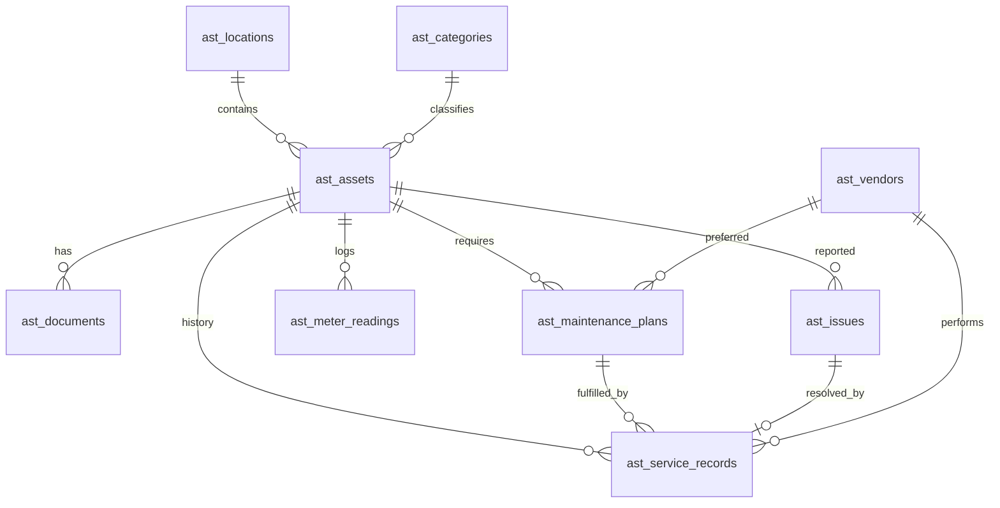

# 🛠️ Modul Asset — Aset & Pemeliharaan Rumah Tangga
**Dokumen:** 03-MODULE-ASSET.md
**Versi:** 0.2
**Fase:** Phase 3
**Prefix tabel:** `ast_` · **Prefix task:** `AST-` · **Namespace:** `App\Modules\Asset`
**Prasyarat:** Phase 0 selesai; Phase 1 (Finance) untuk integrasi biaya; Phase 2 (Organizer) untuk kalender UI (tanpa Organizer, item tetap muncul di dashboard).

---

## 1. Tujuan
1. Mencatat **aset** rumah tangga (elektronik, kendaraan, perabot, bagian rumah) beserta nota, garansi, dan dokumen.
2. **Tidak pernah lupa** jadwal perawatan (cuci AC, ganti oli, kuras toren, servis berkala) dan masa berlaku dokumen (garansi, pajak STNK, asuransi).
3. Menyimpan **riwayat servis & perbaikan** beserta biaya → otomatis menjadi pengeluaran (Finance).
4. Mencatat **laporan kerusakan** di rumah dan menindaklanjutinya sampai selesai.
5. Menyimpan **kontak vendor/teknisi** langganan.

## 2. Scope

| Masuk MVP | Ditunda (v1.1+) | Tidak dibangun |
|---|---|---|
| Inventaris aset + foto + lokasi/ruangan + kategori | QR label per aset | Depresiasi akuntansi |
| Dokumen berkedaluwarsa (garansi, STNK, asuransi, dll) + pengingat | Total Cost of Ownership chart | Marketplace teknisi |
| Rencana perawatan berbasis **waktu** dan **meter** (km/jam) | Estimasi tanggal dari rata-rata pemakaian meter (sudah dirancang, rilis v1.1) | |
| Riwayat servis + biaya → transaksi Finance | Akses link untuk teknisi | |
| Rencana biaya perawatan → PlannedItem Finance (opsional per rencana) | | |
| Vendor/teknisi + tombol WhatsApp | | |
| Laporan kerusakan sederhana | | |

## 3. Glosarium

| UI | Kode | Definisi |
|---|---|---|
| Aset | `Asset` | Barang/bagian rumah yang dirawat atau punya nilai |
| Lokasi | `Location` | Ruangan/area: Ruang Tamu, Dapur, Kamar Utama, Garasi, Atap |
| Dokumen | `AssetDocument` | Dokumen dengan masa berlaku: garansi, STNK, asuransi, sertifikat |
| Rencana Perawatan | `MaintenancePlan` | Perawatan berkala (preventif) |
| Catatan Servis | `ServiceRecord` | Kejadian servis/perbaikan yang **sudah** dilakukan |
| Laporan Kerusakan | `Issue` | Masalah yang ditemukan dan perlu ditangani |
| Vendor | `Vendor` | Teknisi/bengkel/toko servis |
| Meter | – | Angka pemakaian: odometer (km) atau jam pakai (genset, pompa) |

---

## 4. User Stories & Acceptance Criteria

### US-AST-01 Tambah aset
- **AC1** Field: nama (wajib), kategori (wajib), lokasi, merek, model, nomor seri, tanggal beli, harga beli, dibeli di, foto (maks 5), catatan, status.
- **AC2** Kategori kendaraan menampilkan field tambahan: nomor polisi, satuan meter = `km`, odometer saat ini.
- **AC3** Field cepat "Garansi sampai" (tanggal) atau "Garansi (bulan)" → otomatis membuat `AssetDocument` tipe `warranty`.
- **AC4** Opsi "Catat pembelian sebagai pengeluaran" (jika harga diisi & integrasi aktif) → `FinanceGateway::recordExpense` (source `ast_asset`). Simpan `purchase_transaction_id` hanya jika gateway mengembalikan ID; hasil `null` tidak menggagalkan simpan aset dan bukan transaksi tercatat.
- **AC5** Setelah simpan, tampilkan saran rencana perawatan berdasarkan **template kategori** (§11), user centang yang diinginkan.

### US-AST-02 Daftar & detail aset
- **AC1** Daftar: kartu dengan foto thumb, nama, lokasi, badge status perawatan terdekat (`Terlambat`/`Segera`/`OK`), badge garansi (`Garansi s/d Mar 2027` / `Garansi habis`).
- **AC2** Filter: kategori, lokasi, status, "butuh perhatian" (ada perawatan terlambat/dokumen ≤30 hari/kerusakan terbuka). Cari: nama, merek, model, nomor seri, nopol.
- **AC3** Kelompokkan: per Lokasi (default) atau per Kategori.
- **AC4** Detail aset — tab: **Ringkasan** (info, foto, total biaya servis 12 bln & sepanjang masa), **Perawatan** (rencana + next due), **Riwayat** (servis, timeline), **Dokumen**, **Kerusakan**.

### US-AST-03 Dokumen & garansi
- **AC1** Field: tipe (`warranty`, `vehicle_tax_annual` (pajak STNK tahunan), `vehicle_registration_5y` (STNK/plat 5 tahunan), `insurance`, `inspection` (KIR, dll), `certificate`, `other`), nomor dokumen, penerbit, tanggal terbit, **berlaku sampai**, pengingat (default H-30, H-7, H0), file lampiran, catatan.
- **AC2** Dokumen tanpa tanggal kedaluwarsa diperbolehkan (mis. manual book, nota) — tidak masuk kalender.
- **AC3** "Perpanjang": membuat dokumen baru tipe sama (tanggal berlaku baru), dokumen lama ditandai `superseded`. Untuk pajak tahunan: opsi catat biaya → transaksi Finance (kategori "Pajak Kendaraan").
- **AC4** Opsi "Masukkan biaya perpanjangan ke rencana keuangan" + estimasi → PlannedItem Finance pada tanggal kedaluwarsa (source `asset_document`… lihat BR-AST-031).

### US-AST-04 Rencana perawatan
- **AC1** Field: nama ("Cuci AC", "Ganti oli mesin"), aset, jenis pemicu (`Waktu`, `Meter`, `Waktu atau Meter — mana yang lebih dulu`), interval waktu (angka + `hari/minggu/bulan/tahun`), interval meter (angka), terakhir dilakukan (tanggal & meter), estimasi biaya, vendor langganan, pengingat H-n (default 7), "Masukkan ke rencana keuangan" (toggle), instruksi/catatan (mis. "Pakai oli 10W-40, 0,8 L").
- **AC2** Sistem menghitung **next due date** dan/atau **next due meter** (BR-AST-010..013).
- **AC3** Status rencana: `OK`, `Segera` (≤ remind_days atau ≤ 10% interval meter), `Jatuh tempo` (hari ini/meter tercapai), `Terlambat`.
- **AC4** Tombol "Tandai selesai" → membuka form Catatan Servis yang sudah terisi (aset, rencana, tanggal hari ini, meter saat ini, vendor, biaya estimasi).
- **AC5** "Tunda" (snooze): geser next due N hari dengan alasan, tanpa mengubah last done.

### US-AST-05 Catatan servis / perbaikan
- **AC1** Field: aset (wajib), jenis (`Perawatan rutin`, `Perbaikan`, `Pemeriksaan`), tanggal, meter (jika aset bermeter), vendor (pilih/buat cepat), biaya (bigint, boleh 0), deskripsi pekerjaan, suku cadang (teks), garansi servis sampai (opsional → buat dokumen `warranty` "Garansi servis"), lampiran (nota, foto sebelum/sesudah), terkait rencana perawatan (opsional), terkait laporan kerusakan (opsional).
- **AC2** Jika biaya > 0 dan integrasi aktif → toggle "Catat sebagai pengeluaran" (default ON) + akun + kategori (default sistem `asset_maintenance`; kendaraan → sub "Servis Kendaraan" bila ada) → `FinanceGateway::recordExpense` (source `ast_service_record`). Simpan `transaction_id` hanya jika ID dikembalikan; hasil `null` tidak menggagalkan simpan servis.
- **AC3** Jika terkait rencana: rencana `last_done_on/meter` diperbarui, next due dihitung ulang, reminder dijadwalkan ulang. Jika Finance aktif dan transaksi biaya berhasil dibuat, PlannedItem Finance lama (jika ada) **dibayar** dengan transaksi ini (kirim `plannedItemId` pada ExpenseData); jika tidak ada transaksi, batalkan item lama yang belum selesai. PlannedItem berikutnya dibuat hanya jika integrasi Finance aktif.
- **AC4** Jika terkait laporan kerusakan → kerusakan menjadi `resolved`.
- **AC5** Jika `transaction_id` ada, edit biaya → `FinanceGateway::updateExpense`; hapus catatan servis → tanya "Hapus juga transaksi pengeluarannya?" (default ya → `deleteExpense`). Jika ID null, jangan panggil update/delete. Rencana dihitung ulang dari catatan servis terakhir yang tersisa.

### US-AST-06 Update meter
- **AC1** Dari detail aset atau FAB (aset kendaraan favorit), input angka meter + tanggal.
- **AC2** Pembacaan normal tidak boleh lebih kecil dari pembacaan fisik terakhir. Untuk reset/penggantian odometer atau jam meter, minta konfirmasi dan angka fisik baru; hitung offset sehingga pembacaan kumulatif internal tetap monoton dan progres rencana servis tidak mundur.
- **AC3** Setelah update, status rencana berbasis meter dihitung ulang; jika mencapai "Segera"/"Jatuh tempo" → notifikasi.
- **AC4** Pengingat bulanan opsional "Update odometer {nopol}" tanggal 1 pukul 19:00.

### US-AST-07 Laporan kerusakan
- **AC1** Quick add dari FAB "Laporan Kerusakan": judul ("Keran wastafel bocor"), aset (opsional), lokasi, prioritas (`Rendah`/`Sedang`/`Mendesak`), foto, deskripsi.
- **AC2** Status: `open` → `scheduled` (isi tanggal & vendor; tampil di kalender) → `in_progress` → `resolved` (via catatan servis atau "Selesai tanpa biaya" / "Diperbaiki sendiri") | `cancelled`.
- **AC3** Daftar kerusakan: tab Terbuka / Selesai; urut prioritas lalu umur; badge "terbuka 12 hari".
- **AC4** Notifikasi ke pasangan saat laporan **mendesak** dibuat.

### US-AST-08 Vendor
- **AC1** Field: nama, jenis layanan (AC, listrik, pipa/ledeng, bengkel motor, bengkel mobil, elektronik, bangunan, kebersihan, lainnya — multi), telepon, WhatsApp, alamat, catatan, rating 1–5, favorit.
- **AC2** Tombol **WhatsApp** membuka `https://wa.me/62xxxx?text=` dengan pesan template: "Halo {nama}, saya {user} dari {household}. Ingin servis {aset} ({merek model}) di {lokasi}. Kapan bisa?" — nomor dinormalisasi (0812… → 62812…).
- **AC3** Detail vendor menampilkan riwayat servis + total biaya ke vendor tsb.

### US-AST-09 Pelepasan aset
- **AC1** Ubah status ke `Dijual`/`Dibuang`/`Hilang` dengan tanggal; jika dijual → opsi catat pemasukan (harga jual) via Finance (perlu kontrak `recordIncome` — lihat Q-A6; default: dicatat manual oleh user).
- **AC2** Aset dilepas: semua rencana perawatan nonaktif, reminder & PlannedItem Finance masa depan dibatalkan, tidak muncul di daftar default (filter "Termasuk yang dilepas").

---

## 5. Data Model

Konvensi Masterplan §6 (ULID, household_id, created_by, timestamps, softDeletes, bigint uang).

### 5.1 `ast_locations`
`name` string(60), `icon` string nullable, `sort_order` int. Seed: Ruang Tamu, Ruang Keluarga, Dapur, Kamar Utama, Kamar Anak, Kamar Mandi, Garasi/Carport, Halaman, Atap & Plafon, Lainnya.

### 5.2 `ast_categories`
| Kolom | Tipe | Aturan |
|---|---|---|
| name | string(60) | |
| icon | string | |
| meter_unit | string nullable `MeterUnit` | `km`, `hour` — default satuan untuk aset baru di kategori ini |
| is_vehicle | bool | menampilkan field kendaraan |
| system_key | string nullable | untuk template perawatan |
Seed (system_key): Elektronik (`electronics`), AC (`air_conditioner`), Peralatan Dapur (`kitchen`), Mesin Cuci & Laundry (`laundry`), Kendaraan Motor (`motorcycle`, km, vehicle), Kendaraan Mobil (`car`, km, vehicle), Gadget & Komputer (`gadget`), Furnitur (`furniture`), Instalasi Air & Pompa (`plumbing`), Instalasi Listrik (`electrical`), Bangunan (`building`), Taman (`garden`), Lainnya (`other`).

### 5.3 `ast_assets`
| Kolom | Tipe | Aturan |
|---|---|---|
| name | string(100) | |
| category_id | FK | |
| location_id | FK nullable | |
| brand, model | string(60) nullable | |
| serial_number | string(80) nullable | |
| plate_number | string(15) nullable | kendaraan; uppercase tanpa spasi ganda |
| purchase_date | date nullable | |
| purchase_price | bigint nullable | |
| purchased_from | string(100) nullable | |
| purchase_transaction_id | ULID nullable | |
| status | string `AssetStatus` | `active`, `in_repair`, `sold`, `disposed`, `lost` |
| disposed_on | date nullable | |
| meter_unit | string nullable | |
| current_meter | unsigned int nullable | snapshot/cache dari `ast_meter_readings` kumulatif terbaru; bukan sumber kebenaran |
| meter_updated_on | date nullable | tanggal dari pembacaan terbaru |
| is_favorite | bool | muncul di FAB update meter |
| notes | text nullable | |
Media collection: `photos` (maks 5).

### 5.4 `ast_documents`
| Kolom | Tipe | Aturan |
|---|---|---|
| asset_id | FK nullable | dokumen bisa tanpa aset (mis. asuransi rumah) |
| type | string `DocumentType` | lihat US-AST-03 |
| title | string(100) | default dari tipe + nama aset |
| number | string(80) nullable | |
| issuer | string(100) nullable | |
| issued_on | date nullable | |
| expires_on | date nullable | index |
| remind_days | text (cast array int) default `[30,7,0]` | |
| status | string `DocumentStatus` | `active`, `superseded`, `expired` (derived saat tampil; disimpan hanya `active`/`superseded`) |
| renewal_cost_estimate | bigint nullable | |
| add_to_finance_plan | bool default false | |
| notes | text nullable | |
Media collection: `files`.

### 5.5 `ast_maintenance_plans`
| Kolom | Tipe | Aturan |
|---|---|---|
| asset_id | FK | |
| name | string(100) | |
| trigger | string `MaintenanceTrigger` | `time`, `meter`, `time_or_meter` |
| interval_value | smallint nullable | wajib jika trigger mengandung time |
| interval_unit | string nullable `IntervalUnit` | `day`,`week`,`month`,`year` |
| meter_interval | unsigned int nullable | wajib jika trigger mengandung meter |
| last_done_on | date nullable | |
| last_done_meter | unsigned int nullable | |
| next_due_on | date nullable | **disimpan** (hasil kalkulasi) & index |
| next_due_meter | unsigned int nullable | disimpan |
| snoozed_until | date nullable | |
| estimated_cost | bigint nullable | |
| vendor_id | FK nullable | |
| remind_days_before | tinyint default 7 | |
| add_to_finance_plan | bool default false | |
| instructions | text nullable | |
| is_active | bool default true | |

### 5.6 `ast_service_records`
| Kolom | Tipe | Aturan |
|---|---|---|
| asset_id | FK | |
| maintenance_plan_id | FK nullable | |
| issue_id | FK nullable | |
| type | string `ServiceType` | `preventive`, `repair`, `inspection` |
| performed_on | date | index |
| meter_reading | unsigned int nullable | |
| vendor_id | FK nullable | |
| cost | bigint default 0 | |
| description | text nullable | |
| parts | string(255) nullable | |
| transaction_id | ULID nullable | |
| service_warranty_document_id | FK nullable | |
Media collection: `attachments`.

### 5.7 `ast_meter_readings`
`asset_id` FK, `raw_reading` unsigned int (angka fisik pada odometer/meter), `cumulative_offset` unsigned int default 0, `reading` unsigned int (nilai kumulatif = `raw_reading + cumulative_offset`, dipakai untuk jadwal perawatan), `read_on` date, `is_reset` bool, `source` string (`manual`,`service_record`), timestamps. Index (`asset_id`,`read_on`). Nilai `meter_reading` pada form/catatan servis adalah angka fisik mentah; sistem menormalisasikannya dengan offset aktif yang sama seperti input manual.

### 5.8 `ast_vendors`
`name` string(100), `services` text (cast array of `VendorService`), `phone` string(20) nullable, `whatsapp` string(20) nullable (format 62…), `address` string(255) nullable, `notes` text nullable, `rating` tinyint nullable 1–5, `is_favorite` bool.

### 5.9 `ast_issues`
| Kolom | Tipe | Aturan |
|---|---|---|
| title | string(150) | |
| description | text nullable | |
| asset_id | FK nullable | |
| location_id | FK nullable | |
| priority | string `IssuePriority` | `low`,`medium`,`urgent` |
| status | string `IssueStatus` | `open`,`scheduled`,`in_progress`,`resolved`,`cancelled` |
| scheduled_on | date nullable | wajib jika scheduled |
| vendor_id | FK nullable | |
| resolved_on | date nullable | |
| resolution_note | string(255) nullable | |
| reported_by | FK users | |
Media collection: `photos`.

### 5.10 ERD

---

## 6. Aturan Bisnis

| ID | Aturan |
|---|---|
| BR-AST-001 | Aset dengan catatan servis tidak bisa dihapus permanen; hanya dilepas (status) atau soft delete dengan konfirmasi ketik nama aset. |
| BR-AST-002 | `ast_meter_readings` adalah sumber kebenaran meter. `current_meter`/`meter_updated_on` pada aset hanyalah snapshot yang diperbarui atomik dari pembacaan kumulatif terbaru (`read_on` terbesar, lalu `created_at`); catatan servis dengan meter otomatis menambah reading (`source=service_record`). |
| BR-AST-003 | Pada pembacaan biasa, `raw_reading` tidak boleh turun. Saat meter fisik di-reset/diganti, `is_reset=true` dan `cumulative_offset = max(latest cumulative reading − new raw_reading, 0)`, sehingga `reading = raw_reading + cumulative_offset` tidak pernah turun (meter baru yang sudah lebih tinggi dari progres lama membuat nilai kumulatif melonjak, bukan mundur); minta konfirmasi dan catat reset. Semua perbandingan jadwal memakai nilai `reading` kumulatif. |
| BR-AST-010 | **Waktu:** `next_due_on = (last_done_on ?? purchase_date ?? created_at.date) + interval`. Untuk unit `month`/`year` gunakan penambahan kalender tanpa overflow (`addMonthsNoOverflow`). |
| BR-AST-011 | **Meter:** `next_due_meter = (last_done_meter ?? latest asset meter reading at plan creation ?? 0) + meter_interval`. Semua evaluasi status memakai pembacaan terbaru dari `ast_meter_readings`, bukan snapshot yang stale. |
| BR-AST-012 | **Waktu atau meter:** keduanya dihitung; status mengambil yang paling mendesak. |
| BR-AST-013 | Jika `snoozed_until` > next_due_on → tanggal efektif = `snoozed_until`. Snooze direset saat ada catatan servis baru. |
| BR-AST-014 | Status rencana (derived): `overdue` jika tanggal efektif < hari ini atau current_meter > next_due_meter; `due` jika = hari ini atau current_meter = next_due_meter (± 0); `soon` jika tanggal efektif ≤ hari ini + remind_days_before atau (next_due_meter − current_meter) ≤ 10% meter_interval; selain itu `ok`. |
| BR-AST-015 | *(v1.1)* Estimasi tanggal meter: rata-rata pemakaian/hari dari pembacaan 90 hari terakhir (min 2 pembacaan) → `estimated_due_on` untuk kalender. Di MVP, rencana berbasis meter murni **tidak** tampil di kalender; hanya di alert/dashboard. |
| BR-AST-020 | Mencatat servis untuk rencana menggunakan `performed_on`/`meter_reading` servis sebagai `last_done_*` **hanya jika** lebih baru dari nilai saat ini (input servis lama tidak memundurkan jadwal). |
| BR-AST-021 | Hapus catatan servis → `last_done_*` rencana = catatan servis terbaru yang tersisa untuk rencana itu, atau null. |
| BR-AST-030 | Integrasi Finance (rencana perawatan): jika `add_to_finance_plan` & `estimated_cost` & trigger mengandung waktu → `FinanceGateway::upsertPlannedExpense` dengan `sourceType='asset_maintenance'`, `sourceId=plan.id`, `dueDate=next_due_on`, nama `"Perawatan: {plan.name} – {asset.name}"`; hasil null tidak disimpan sebagai ID. Jika tanggal berubah karena edit/snooze atau reschedule lain, batalkan item lama yang masih `planned` lalu upsert item untuk tanggal baru (`cancelPlannedExpenses(..., fromDate)`). Jika opsi integrasi pada rencana dimatikan, batalkan item mendatang yang masih `planned`. Jika servis menyelesaikan item terencana dan transaksi dikaitkan melalui `plannedItemId`, item tersebut harus diselesaikan sebagai paid oleh FinanceGateway, bukan dibatalkan; buat/upsert item untuk jadwal servis berikutnya hanya jika integrasi aktif. |
| BR-AST-031 | Integrasi Finance (dokumen): sama dengan BR-AST-030 memakai `sourceType='asset_document'` dan `dueDate=expires_on`, nama `"Perpanjang: {title}"`; hasil null tidak disimpan sebagai ID atau ditampilkan sebagai rencana tercatat. Jika opsi rencana keuangan dokumen dimatikan, batalkan item mendatang yang masih `planned`. |
| BR-AST-033 | Biaya servis/dokumen mengikuti rincian kategori dan alokasi Finance US-FIN-04A, default Kebutuhan Hidup untuk perawatan rumah/kendaraan. Pembelian aset memakai alokasi yang dipilih sesuai tujuan (kebutuhan atau tersier), bukan selalu kebutuhan. Realisasi pembayaran PlannedItem masuk ringkasan alokasi sekali, bukan sebagai transaksi tambahan. |
| BR-AST-032 | Saat integrasi dinonaktifkan, seluruh PlannedItem Asset yang masih `planned` dibatalkan melalui gateway aktif sebelum flag household dimatikan (lihat Masterplan §4); kegagalan pembatalan membuat integrasi tetap aktif. Aset dilepas → PlannedItem aset terkait dibatalkan. |
| BR-AST-040 | Normalisasi nomor WhatsApp: hapus spasi/tanda; awalan `0` → `62`; awalan `+62` → `62`; validasi 10–15 digit. |
| BR-AST-041 | Issue `scheduled` wajib `scheduled_on` ≥ hari ini (saat diset). |
| BR-AST-050 | Dokumen `superseded` tidak mendapat pengingat dan tidak tampil di kalender. |

---

## 7. Halaman & Komponen

| Route | Komponen | Keterangan |
|---|---|---|
| `GET /assets` | `Asset\Assets\Index` | US-AST-02 + tab atas: **Aset** · **Perawatan** · **Kerusakan** · **Vendor** |
| `GET /assets/create`, `/{id}`, `/{id}/edit` | `Asset\Assets\Form`, `Show` | US-AST-01/02 |
| `GET /assets/maintenance` | `Asset\Maintenance\Index` | Semua rencana lintas aset, grup: Terlambat → Jatuh tempo → Segera → OK |
| `GET /assets/{asset}/plans/create`, `/plans/{id}/edit` | `Asset\Maintenance\Form` | US-AST-04 |
| `GET /assets/{asset}/services/create?plan=&issue=`, `/services/{id}` | `Asset\Services\Form`, `Show` | US-AST-05 |
| `GET /assets/{asset}/documents/create`, `/documents/{id}` | `Asset\Documents\Form` | US-AST-03 |
| `GET /assets/documents` | `Asset\Documents\Index` | semua dokumen; filter "kedaluwarsa ≤ 60 hari" |
| `GET /assets/issues`, `/issues/create`, `/issues/{id}` | `Asset\Issues\*` | US-AST-07 |
| `GET /assets/vendors`, `/vendors/{id}` | `Asset\Vendors\*` | US-AST-08 |
| `GET /assets/locations` | `Asset\Locations\Index` | CRUD sederhana + urutan |

FAB: "Laporan Kerusakan", "Update Odometer" (jika ada aset favorit bermeter). Menu `Lainnya` → `Aset`.

---

## 8. Integrasi

### 8.1 Calendar Sources
| Key | Item | Warna | URL |
|---|---|---|---|
| `asset.maintenance` | Rencana aktif dengan tanggal efektif (trigger waktu / waktu-atau-meter) | overdue `#E11D48`, lainnya `#EA580C` | `/assets/{asset}#plan-{id}` |
| `asset.documents` | Dokumen `active` dengan expires_on | `#9333EA` | `/assets/documents/{id}` |
| `asset.issues` | Issue `scheduled` (scheduled_on) | `#0891B2` | `/assets/issues/{id}` |
Judul: `"🔧 {plan.name} · {asset.name}"`, `"📄 {title} berakhir"`, `"🛠️ {issue.title} (teknisi)"`.

### 8.2 Alert Source — `AssetAlertSource`
| Level | Kondisi |
|---|---|
| danger | Perawatan terlambat (digabung bila > 1) · Dokumen sudah kedaluwarsa (pajak/asuransi) · Issue `urgent` terbuka |
| warning | Perawatan jatuh tempo/segera · Dokumen berakhir ≤ 30 hari |
| info | Garansi berakhir ≤ 30 hari ("Garansi Kulkas Sharp berakhir 12 Des — cek kondisi sebelum habis") |

### 8.3 Reminder
| Sumber | Key | Waktu |
|---|---|---|
| MaintenancePlan (waktu) | `h-{n}`, `h0` | tanggal efektif − n, 08:00; dan hari H 08:00 |
| MaintenancePlan (meter) | `meter-soon`, `meter-due` | segera saat update meter melewati ambang (tidak terjadwal) → notifikasi langsung |
| Document | `h-30`, `h-7`, `h0` (sesuai `remind_days`) | 08:00 |
| Issue scheduled | `h-1` | scheduled_on − 1 hari, 19:00 |
| Update odometer (opsional) | `odometer-monthly` | tanggal 1, 19:00 |

### 8.4 Finance (via `FinanceGateway`)
| Aksi Asset | Panggilan |
|---|---|
| Simpan pembelian aset (opsional) | `recordExpense(source='ast_asset')` |
| Simpan catatan servis berbiaya | `recordExpense(source='ast_service_record', plannedItemId=?)` |
| Ubah/hapus biaya servis | `updateExpense` / `deleteExpense` |
| Rencana perawatan/dokumen `add_to_finance_plan` | `upsertPlannedExpense` / `cancelPlannedExpenses` |
| Finance event `PlannedItemSettled` (source asset_maintenance) dibayar **dari halaman Finance** (bukan dari servis) | Listener Asset: tampilkan notifikasi "Tagihan perawatan dibayar — catat servisnya?" dengan link form servis terisi (tidak otomatis membuat catatan servis) |

### 8.5 Dashboard Widget — `AssetAttentionWidget`
Jumlah perawatan terlambat/segera, dokumen berakhir ≤ 30 hari, kerusakan terbuka; tombol ke `/assets/maintenance`.

### 8.6 Household Exporter
`assets.csv`, `locations.csv`, `documents.csv`, `maintenance_plans.csv`, `service_records.csv`, `meter_readings.csv`, `vendors.csv`, `issues.csv` + semua media.

---

## 9. Scheduled Jobs
| Command | Jadwal | Fungsi |
|---|---|---|
| `assets:refresh-due-dates` | 00:40 | Hitung ulang next_due (defensif), jadwalkan reminder untuk item dalam 35 hari, sinkron PlannedItem Finance |
| `assets:odometer-reminders` | 19:00 tgl 1 | Pengingat update odometer aset favorit (jika diaktifkan user) |

---

## 10. Test Wajib
1. Isolasi household semua route/Livewire/media (signed URL lintas household → 403/404).
2. Kalkulasi next due: waktu (bulan, 31 Jan + 1 bulan), meter kumulatif, waktu-atau-meter, snooze, reset meter mempertahankan pembacaan kumulatif, servis lama tidak memundurkan (BR-AST-020), hapus servis (BR-AST-021).
3. Status derived (`overdue/due/soon/ok`) untuk tabel kasus.
4. Catatan servis berbiaya → FinanceGateway dipanggil benar; ID hanya disimpan jika hasil non-null; edit/hapus memanggil update/delete hanya bila ID transaksi ada; integrasi off/null tidak menghalangi simpan servis.
5. Rencana `add_to_finance_plan`: upsert saat dibuat, cancel+buat ulang saat next due berubah, cancel saat aset dilepas.
6. Meter: tolak pembacaan menurun tanpa reset; reading dari servis.
7. Normalisasi WhatsApp & pesan template ter-encode URL.
8. Perpanjang dokumen: lama superseded, reminder lama dibatalkan.
9. Calendar sources & alert source menghasilkan item/alert sesuai kondisi.

---

## 11. Template Perawatan per Kategori (saran saat tambah aset)

| Kategori | Rencana | Pemicu | Interval |
|---|---|---|---|
| AC | Cuci AC | waktu | 3 bulan |
| AC | Cek freon & servis besar | waktu | 12 bulan |
| Kendaraan Motor | Ganti oli mesin | waktu atau meter | 2 bulan / 2.000 km |
| Kendaraan Motor | Servis berkala (CVT/injeksi) | waktu atau meter | 4 bulan / 4.000 km |
| Kendaraan Motor | Ganti ban | meter | 20.000 km |
| Kendaraan Mobil | Ganti oli mesin + filter | waktu atau meter | 6 bulan / 10.000 km |
| Kendaraan Mobil | Servis berkala | waktu atau meter | 6 bulan / 10.000 km |
| Kendaraan Mobil | Ganti aki | waktu | 24 bulan |
| Mesin Cuci & Laundry | Bersihkan tabung | waktu | 1 bulan |
| Peralatan Dapur (kulkas) | Bersihkan kulkas & cek karet pintu | waktu | 3 bulan |
| Peralatan Dapur (kompor gas) | Cek selang & regulator | waktu | 6 bulan |
| Instalasi Air & Pompa | Kuras toren/tandon | waktu | 6 bulan |
| Instalasi Air & Pompa | Ganti filter air | waktu | 3 bulan |
| Instalasi Listrik | Cek MCB & instalasi | waktu | 12 bulan |
| Bangunan | Cek atap & talang (jelang musim hujan) | waktu | 12 bulan |
| Bangunan | Kuras septic tank | waktu | 36 bulan |
| Bangunan | Fogging/anti rayap | waktu | 12 bulan |
| Taman | Pangkas pohon | waktu | 6 bulan |

Template disimpan sebagai config `config/asset_templates.php` (bukan tabel), di-mapping via `system_key` kategori. Interval bisa diubah user sebelum disimpan.

---

## 12. Task Breakdown

| ID | Judul | Isi | Dep |
|---|---|---|---|
| AST-01 | Skema & model | Migrasi §5, model, enum, factory, provider, routes, feature flag, seed lokasi & kategori saat household dibuat | CORE-* |
| AST-02 | Aset CRUD | US-AST-01 (tanpa saran template & Finance), US-AST-02 daftar/filter/detail kerangka tab, foto | 01 |
| AST-03 | Lokasi & vendor | CRUD lokasi, US-AST-08 + WhatsApp | 01 |
| AST-04 | Dokumen | US-AST-03 (tanpa Finance) + perpanjang | 02 |
| AST-05 | Meter | US-AST-06, `ast_meter_readings` | 02 |
| AST-06 | Rencana perawatan | US-AST-04, kalkulasi BR-AST-010..014, snooze, template §11 | 02, 05 |
| AST-07 | Catatan servis | US-AST-05 (tanpa Finance), update rencana, BR-AST-020/021 | 06 |
| AST-08 | Laporan kerusakan | US-AST-07 | 07 |
| AST-09 | Integrasi Finance – transaksi | Pembelian aset & biaya servis via FinanceGateway | 07, FIN-13 |
| AST-10 | Integrasi Finance – rencana | BR-AST-030..032 + listener PlannedItemSettled | 09 |
| AST-11 | Kalender, alert, reminder, widget | §8.1–8.3, §8.5, jobs §9 | 06, 04, 08, CORE-09/11 |
| AST-12 | Pelepasan aset, exporter, polish | US-AST-09, exporter, empty states, dark mode, 360px, offline cache `/assets` | semua |

---

## 13. Open Questions — Asset

| ID | Pertanyaan | Default Assumption |
|---|---|---|
| Q-A1 | Batas aset yang dicatat: semua barang atau hanya yang dirawat/bernilai? | Bebas; disarankan hanya yang punya garansi, perawatan, atau nilai ≥ Rp 500.000 (tidak divalidasi) |
| Q-A2 | Apakah rumah itu sendiri dicatat sebagai aset (PBB, IPL, renovasi)? | Ya, kategori "Bangunan"; PBB & IPL tetap dikelola sebagai Tagihan Rutin di Finance |
| Q-A3 | Konsumsi BBM kendaraan perlu dilacak (km/liter)? | Tidak; BBM cukup sebagai transaksi kategori Bensin |
| Q-A4 | Teknisi perlu akses (link tamu) ke riwayat aset? | Tidak (non-goal) |
| Q-A5 | Interval template perawatan (§11) sesuai kebiasaan keluarga Anda? Ada yang perlu ditambah (water heater, CCTV, genset)? | Pakai tabel §11 |
| Q-A6 | Penjualan aset otomatis dicatat sebagai pemasukan? (butuh `FinanceGateway::recordIncome`) | Tidak di MVP; user catat manual |
